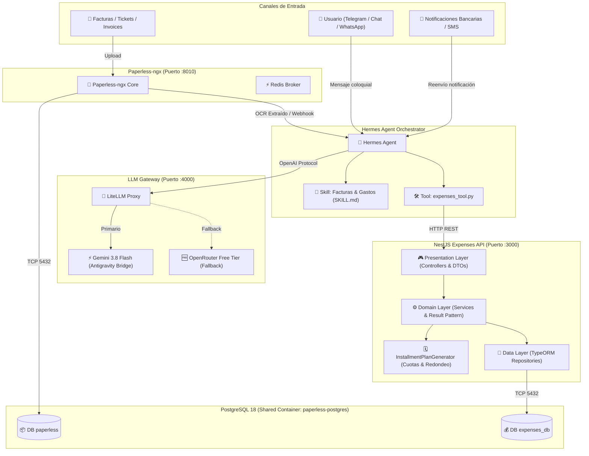
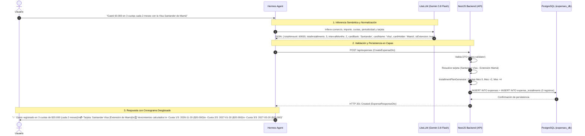
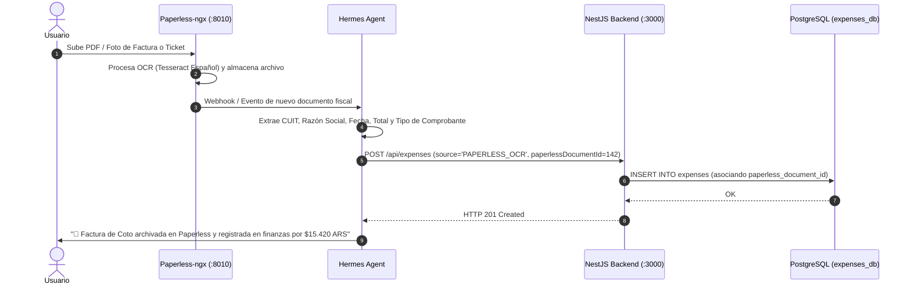
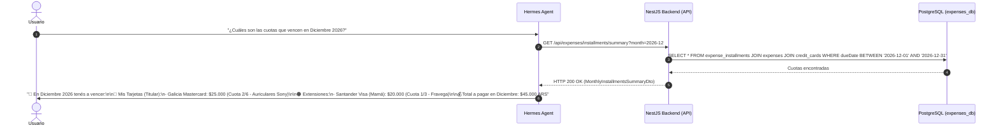
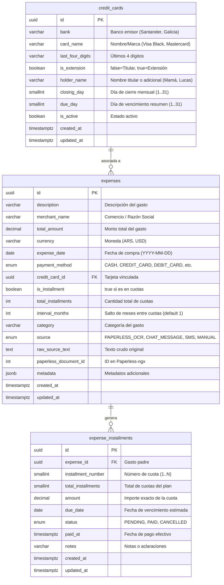

# NestJS Expenses API 🚀

API backend para registro, análisis, seguimiento y proyección de gastos financieros personales, con ingesta automática desde comprobantes OCR (**Paperless-ngx**), mensajes coloquiales y SMS bancarios orquestados por **Hermes Agent**, gestión de compras en múltiples cuotas (mensuales o aperiódicas con saltos de meses), y catálogo discriminado de tarjetas titulares y extensiones familiares.

Desarrollada bajo **Clean Architecture & DDD** con **NestJS 12**, **Node 26 LTS**, **TypeORM 11**, validación de variables de entorno con **Zod**, DTOs fuertemente tipados con **class-validator**, suite de pruebas unitarias con **Vitest**, y persistencia en **PostgreSQL 18** (reutilizando la instancia compartida en Proxmox).

---

## 🏛️ Arquitectura Global del Ecosistema



---

## 📊 Flujos de Datos e Interacción

### 1. Ingesta desde Mensajes Libres o SMS Bancarios (Cuotas e Intervalos)

El usuario escribe en lenguaje natural o reenvía un SMS del banco. Hermes extrae los campos semánticos y llama a la API persistiendo el gasto y su cronograma de cuotas:



---

### 2. Ingesta Documental vía Paperless-ngx OCR



---

### 3. Consulta de Cuotas Pendientes y Vencimientos del Mes

Permite auditar los compromisos financieros de un mes específico, discriminando entre tarjetas propias (titular) y compras hechas por extensiones:



---

## 🗓️ Lógica Matemática de Cuotas e Intervalos (`intervalMonths`)

Cuando un gasto se divide en cuotas, el generador determinístico [`InstallmentPlanGenerator`](file:///home/lucasm/Code/nest-expenses-api/src/modules/expenses/domain/services/installment-plan-generator.ts) ejecuta:

1. **Cálculo de Fechas con Saltos Aperiódicos**:
   $$\text{Fecha Cuota } k = \text{Fecha Inicial} + ((k - 1) \times \text{intervalMonths})$$
   - Si `intervalMonths = 1` (mensual estándar): meses consecutivos.
   - Si `intervalMonths = 2` (bimestral / cada 2 meses): Noviembre 2026 $\rightarrow$ Enero 2027 $\rightarrow$ Marzo 2027.
   - Ajusta automáticamente fines de mes variables (ej. 31 de Enero $\rightarrow$ 28 de Febrero $\rightarrow$ 31 de Marzo).

2. **Compensación Exacta de Centavos (Rounding Loss Prevention)**:
   - Para evitar pérdida o desfasaje de centavos al dividir importes (ej. $\$100 / 3$ cuotas), calcula:
     $$\text{Base} = \lfloor \frac{\text{Total}}{N} \rfloor = 33.33$$
     $$\text{Resto} = \text{Total} - (\text{Base} \times N) = 100.00 - 99.99 = 0.01$$
   - El resto se imputa íntegramente a la **primera cuota**:
     - Cuota 1: $\$33.34$
     - Cuota 2: $\$33.33$
     - Cuota 3: $\$33.33$
     - **Suma exacta garantizada**: $\$100.00$.

---

## 🧩 Modelo Relacional de Datos (PostgreSQL 18)



---

## 🧱 Arquitectura en Capas (Clean Architecture & DDD)

El proyecto está organizado siguiendo separación estricta de responsabilidades:

```text
src/
├── common/
│   └── errors/
│       ├── errors.ts             # Errores canónicos (NotFound, InvalidOperation, CouldNotSave)
│       ├── result.mapper.ts      # Patrón Result<T, BaseError>
│       └── error.mapper.ts       # Mapeo determinístico de BaseError a HttpException
├── infraestructure/
│   ├── config/
│   │   └── env.schema.ts         # Validación estricta de ENVs con ZOD (exclusivo para envs)
│   └── database/
│       └── typeorm.config.ts     # Configuración asíncrona de TypeORM para PostgreSQL 18
└── modules/
    └── expenses/
        ├── domain/
        │   ├── interfaces/       # Contratos puros de dominio (IExpense, ICreditCard, etc.)
        │   └── services/         # IExpensesService (abstract token) e InstallmentPlanGenerator
        ├── data/
        │   ├── entities/         # Entidades TypeORM con índices B-Tree
        │   └── repositories/     # IExpensesRepository (abstract token) y ExpensesRepository
        └── presentation/
            ├── dtos/             # DTOs validados con class-validator y class-transformer
            ├── mappers/          # Mappers estáticos (ExpenseMapper)
            └── controllers/      # ExpensesController evaluando Result y excepciones
```

---

## 🔌 Especificación de Endpoints REST

### 1. Registrar Nuevo Gasto
`POST /api/expenses`

**Payload (Compra en 3 cuotas cada 2 meses con extensión):**
```json
{
  "merchantName": "Fravega",
  "description": "Smart TV 55 Pulgadas",
  "totalAmount": 300000.00,
  "currency": "ARS",
  "expenseDate": "2026-11-08",
  "paymentMethod": "CREDIT_CARD",
  "cardBank": "Santander",
  "cardName": "Visa Black",
  "cardHolder": "Mamá",
  "isInstallment": true,
  "totalInstallments": 3,
  "intervalMonths": 2,
  "category": "TECNOLOGIA",
  "source": "CHAT_MESSAGE",
  "rawSourceText": "gasté 300k en fravega en 3 cuotas cada 2 meses con la visa santander extensión de mamá"
}
```

**Respuesta Exitosa (`201 Created`):**
```json
{
  "id": "e674a9cf-936d-472e-8fa9-906fb3684a22",
  "description": "Smart TV 55 Pulgadas",
  "merchantName": "Fravega",
  "totalAmount": 300000,
  "currency": "ARS",
  "expenseDate": "2026-11-08",
  "paymentMethod": "CREDIT_CARD",
  "isInstallment": true,
  "totalInstallments": 3,
  "intervalMonths": 2,
  "category": "TECNOLOGIA",
  "source": "CHAT_MESSAGE",
  "creditCard": {
    "id": "18cf3b2a-6d1a-4d32-9cb7-7f9a12e83120",
    "bank": "Santander",
    "cardName": "Visa Black",
    "isExtension": true,
    "holderName": "Mamá"
  },
  "installments": [
    {
      "id": "inst-uuid-1",
      "installmentNumber": 1,
      "totalInstallments": 3,
      "amount": 100000,
      "dueDate": "2026-11-20",
      "status": "PENDING"
    },
    {
      "id": "inst-uuid-2",
      "installmentNumber": 2,
      "totalInstallments": 3,
      "amount": 100000,
      "dueDate": "2027-01-20",
      "status": "PENDING"
    },
    {
      "id": "inst-uuid-3",
      "installmentNumber": 3,
      "totalInstallments": 3,
      "amount": 100000,
      "dueDate": "2027-03-20",
      "status": "PENDING"
    }
  ],
  "createdAt": "2026-11-08T19:20:00.000Z"
}
```

---

### 2. Resumen de Cuotas por Mes
`GET /api/expenses/installments/summary?month=2026-12`

**Respuesta Exitosa (`200 OK`):**
```json
{
  "month": "2026-12",
  "totalAmountDue": 45000,
  "installmentsCount": 2,
  "items": [
    {
      "installmentId": "inst-1",
      "expenseId": "exp-1",
      "merchantName": "MercadoLibre",
      "description": "Auriculares Sony",
      "installmentNumber": 2,
      "totalInstallments": 6,
      "amount": 25000,
      "dueDate": "2026-12-10",
      "status": "PENDING",
      "cardBank": "Galicia",
      "cardName": "Mastercard",
      "isExtension": false,
      "holderName": "Lucas M"
    },
    {
      "installmentId": "inst-2",
      "expenseId": "exp-2",
      "merchantName": "Fravega",
      "description": "Smart TV",
      "installmentNumber": 1,
      "totalInstallments": 3,
      "amount": 20000,
      "dueDate": "2026-12-20",
      "status": "PENDING",
      "cardBank": "Santander",
      "cardName": "Visa Black",
      "isExtension": true,
      "holderName": "Mamá"
    }
  ]
}
```

---

### 3. Catálogo de Tarjetas
`GET /api/expenses/cards` / `POST /api/expenses/cards`

Permite listar y dar de alta tarjetas principales y adicionales para asociar gastos y conocer sus días de cierre y vencimiento.

---

### 4. Healthcheck
`GET /api/health`

```json
{
  "status": "ok",
  "service": "nest-expenses-api",
  "timestamp": "2026-11-08T19:25:00.000Z",
  "nodeVersion": "v26.0.0"
}
```

---

## 🧪 Pruebas Unitarias con Vitest

El proyecto utiliza **Vitest** con **unplugin-swc** para ejecución de pruebas a alta velocidad y bajo el patrón **Arrange-Act-Assert (AAA)**:

```bash
# Ejecutar suite completa de tests unitarios
npm test
# o con pnpm
pnpm test

# Modo interactivo con hot reload
npm run test:watch

# Generar reporte de cobertura
npm run test:cov
```

---

## ⚙️ Configuración de Variables de Entorno

Creá tu archivo `.env` en la raíz copiando la plantilla [`env.example`](file:///home/lucasm/Code/nest-expenses-api/.env.example):

```env
# Servidor
PORT=3000
NODE_ENV=production

# Base de datos (PostgreSQL 18 reutilizado en Docker network paperless_default)
DB_HOST=paperless-postgres
DB_PORT=5432
DB_USER=expenses_user
DB_PASSWORD=your_secure_expenses_db_password_here
DB_NAME=expenses_db
DB_SYNCHRONIZE=false
DB_LOGGING=false

# Paperless-ngx
PAPERLESS_BASE_URL=http://paperless:8000
PAPERLESS_API_TOKEN=your_paperless_token_here
```

> **Seguridad**: Nunca incluyas contraseñas reales en archivos versionados. El archivo `.env` está expresamente ignorado en `.gitignore`.

---

## 🐳 Despliegue con Docker

Construcción y ejecución del contenedor multi-stage sobre **Node 26 Alpine**:

```bash
# Compilar imagen de producción
docker build -t nest-expenses-api:latest .

# Ejecutar conectándolo a la red compartida de Paperless
docker run -d \
  --name nest-expenses-api \
  --network paperless_default \
  -p 3000:3000 \
  --env-file .env \
  nest-expenses-api:latest
```
